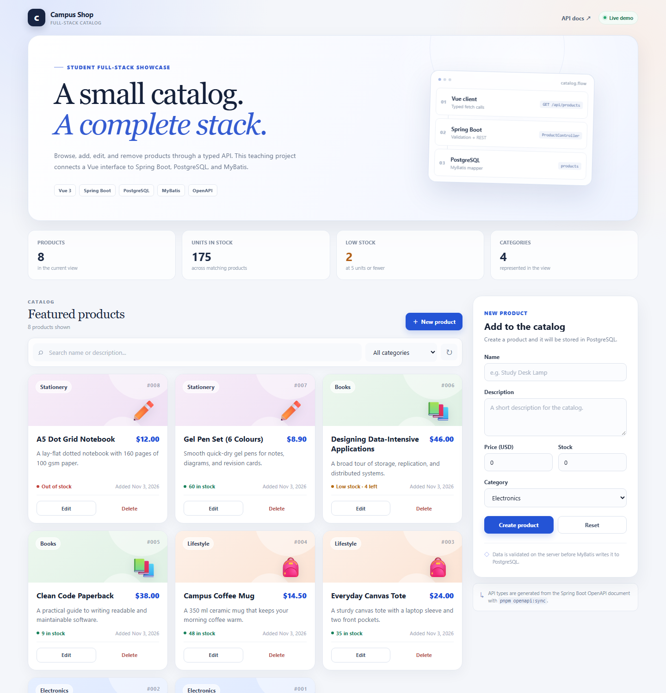

# Campus Shop

A deliberately small full-stack project for student demonstrations. It implements a
product catalog with complete CRUD: browse, search, filter, create, edit, and delete.

The project focuses on the shape of a modern web application rather than visual polish:
a Vue single-page app, a Spring Boot REST API, PostgreSQL persistence through MyBatis,
and a frontend API client generated from the backend's OpenAPI document.

> All repository content is in English: UI copy, documentation, comments, seed data,
> test data, and application messages.

## Live demo

- App: https://kuangshen04.github.io/43030-fullstack-project/
- API: https://106.54.199.108/api/products
- Swagger UI: https://106.54.199.108/swagger-ui.html



## Tech stack

| Layer | Technology |
| --- | --- |
| Frontend | Vue 3, TypeScript, Vite |
| API client | `openapi-typescript` + `openapi-fetch` |
| Backend | Spring Boot 3.5, Spring MVC, Bean Validation |
| Persistence | MyBatis XML mappers, Flyway migrations |
| Database | PostgreSQL 16 |
| API documentation | springdoc-openapi + Swagger UI |
| Monorepo | pnpm workspace |
| Local infrastructure | Docker Compose |
| Deployment | GitHub Pages + Tencent Cloud Lighthouse + Caddy |

## Architecture

```text
┌──────────────────────────────────────────────────────────────────┐
│ Browser                                                          │
│  Vue 3 SPA (apps/web)                                            │
│    └─ @campus-shop/api-client                                    │
│         └─ openapi-fetch + generated OpenAPI types               │
└─────────────────────────────┬────────────────────────────────────┘
                              │ /api/* (Vite dev proxy)
┌─────────────────────────────▼────────────────────────────────────┐
│ Spring Boot API (apps/api)                                       │
│  Controller → Service → MyBatis Mapper → PostgreSQL              │
│  Bean Validation · Global exception handler · Flyway             │
└─────────────────────────────┬────────────────────────────────────┘
                              │ JDBC
                    ┌─────────▼─────────┐
                    │ PostgreSQL 16     │
                    │ products table    │
                    └───────────────────┘

OpenAPI type sync:
  Spring Boot /v3/api-docs
      → scripts/sync-openapi.mjs
      → openapi/openapi.json
      → packages/api-client/src/generated/schema.ts
      → typed Vue API calls
```

## Repository layout

```text
.
├─ apps/
│  ├─ api/                        # Spring Boot + MyBatis backend
│  │  ├─ .mvn/                    # Project-local Maven mirror configuration
│  │  ├─ src/main/java/           # Controllers, service, mapper, DTOs
│  │  ├─ src/main/resources/
│  │  │  ├─ db/migration/         # Flyway schema + demo seed data
│  │  │  └─ mapper/               # MyBatis XML SQL
│  │  └─ src/test/java/           # Web-layer tests
│  └─ web/                        # Vue 3 + Vite application
│     └─ src/
│        ├─ api/                  # Typed request functions
│        ├─ components/           # Product card and editor form
│        ├─ composables/          # Catalog state and actions
│        └─ App.vue               # Page composition
├─ packages/
│  └─ api-client/                 # Generated API types + fetch client
├─ openapi/openapi.json           # Snapshot of the backend OpenAPI document
├─ scripts/sync-openapi.mjs       # Schema/type generation script
├─ docker-compose.yml             # Local PostgreSQL service
└─ pnpm-workspace.yaml
```

## Prerequisites

- Node.js 20.19+ or 22.12+ (Node 22 LTS or newer recommended)
- pnpm 12+ (tested with 12.11.2)
- JDK 21+
- Maven 3.9+
- Docker Desktop or another Docker + Compose installation

## Quick start

From the repository root:

```bash
pnpm install
pnpm db:up
pnpm dev
```

Wait for both services to start, then open:

- App: http://localhost:5173
- Swagger UI: http://localhost:8080/swagger-ui.html
- OpenAPI JSON: http://localhost:8080/v3/api-docs

Local defaults do not require an env file. Copy `apps/web/.env.example` to
`apps/web/.env.local` only when you want to override ports, the Vite proxy target, or
the API URL.

The database is prepared automatically by Flyway on the first API start, including
eight demo products. Stop the applications with `Ctrl+C`, then stop PostgreSQL with:

```bash
pnpm db:down
```

To remove the database volume and recreate the demo data from scratch:

```bash
pnpm db:reset
```

## Useful commands

| Command | Description |
| --- | --- |
| `pnpm dev` | Start the Spring Boot API and Vite dev server together |
| `pnpm dev:api` | Start only the backend |
| `pnpm dev:web` | Start only the frontend |
| `pnpm db:up` | Start PostgreSQL and wait for it to become healthy |
| `pnpm db:down` | Stop the local database container |
| `pnpm db:reset` | Delete the database volume and start a fresh database |
| `pnpm openapi:sync` | Fetch `/v3/api-docs` and regenerate schema + frontend types |
| `pnpm typecheck` | Type-check the Vue application and generated client |
| `pnpm test` | Run backend tests and frontend type checking |
| `pnpm build` | Build the Vue app and package the Spring Boot jar |
| `pnpm preview` | Serve the built Vue app locally on port 4173 |

## OpenAPI type synchronization

The backend is the source of truth. Springdoc turns the controllers and DTOs into an
OpenAPI document, and the frontend types are generated from that document.

With the backend running:

```bash
pnpm openapi:sync
```

This command writes:

1. `openapi/openapi.json` — a readable snapshot of the current contract.
2. `packages/api-client/src/generated/schema.ts` — TypeScript `paths` and `components`
   types used by `openapi-fetch`.

The generated types are committed so the project can be explored without first running
the backend. Do not edit `schema.ts` manually. When a backend DTO or endpoint changes,
run `pnpm openapi:sync` and fix any TypeScript errors in the Vue app.

The sync script reads `SERVER_PORT` and defaults to
`http://localhost:<SERVER_PORT>/v3/api-docs` (port `8080` when unset). To regenerate
types from a deployed API, point `OPENAPI_URL` at its public document:

```bash
OPENAPI_URL=https://api.example.com/v3/api-docs pnpm openapi:sync
```

The API wrapper in `packages/api-client/src/index.ts` provides `createApiClient()` and
exports `Product`, `ProductInput`, and `ApiError` directly from the generated schema.
The web app selects the public API origin at build time, and this is what makes the
frontend request bodies and responses type-safe at compile time.

## API

All endpoints are prefixed with `/api`.

| Method | Path | Purpose |
| --- | --- | --- |
| `GET` | `/api/products` | List products; supports `keyword` and `category` query parameters |
| `GET` | `/api/products/{id}` | Fetch one product |
| `POST` | `/api/products` | Create a product |
| `PUT` | `/api/products/{id}` | Update a product |
| `DELETE` | `/api/products/{id}` | Delete a product |

Example request:

```bash
curl -X POST http://localhost:8080/api/products \
  -H "Content-Type: application/json" \
  -d '{
    "name": "Study Desk Lamp",
    "description": "A warm LED lamp with three brightness levels.",
    "price": 32.50,
    "stock": 15,
    "category": "Lifestyle"
  }'
```

Validation failures return HTTP `400` with a consistent error shape:

```json
{
  "code": "VALIDATION_ERROR",
  "message": "Request validation failed.",
  "details": ["name: Name is required."]
}
```

## Data model

The single `products` table is created by
`apps/api/src/main/resources/db/migration/V1__create_products.sql`:

| Column | Type | Notes |
| --- | --- | --- |
| `id` | `BIGSERIAL` | Primary key |
| `name` | `VARCHAR(120)` | Required |
| `description` | `TEXT` | Defaults to an empty string |
| `price` | `NUMERIC(10, 2)` | Must be non-negative |
| `stock` | `INTEGER` | Must be non-negative |
| `category` | `VARCHAR(40)` | Indexed |
| `created_at` | `TIMESTAMPTZ` | Set on insert |
| `updated_at` | `TIMESTAMPTZ` | Updated when a product changes |

Flyway runs pending migrations automatically on API startup.

## Suggested classroom demo

1. Open the app and point out the Vue → Spring Boot → MyBatis → PostgreSQL flow.
2. Search for a product and filter the catalog by category.
3. Create a product, then show the new row in PostgreSQL if desired.
4. Submit an invalid form to show client-side and server-side validation.
5. Edit a product's stock and price.
6. Delete a product (a confirmation dialog appears).
7. Open Swagger UI and execute `GET /api/products`.
8. Show `openapi/openapi.json` and explain how `pnpm openapi:sync` regenerates the
   TypeScript client types.
9. Run `pnpm test` to demonstrate the backend tests and frontend type check.

To inspect the database directly:

```bash
docker compose exec postgres psql -U campus -d campus_shop
```

```sql
SELECT id, name, price, stock, category FROM products ORDER BY id;
```

## Configuration and split deployment

The defaults below are for local development. Deployment is not automated yet, but the
ports, browser API origin, and CORS settings are ready for a split deployment where the
frontend runs on GitHub Pages and the backend runs on a Lighthouse server.

### Frontend configuration

Vite reads `apps/web/.env*` files. Copy `apps/web/.env.example` to
`apps/web/.env.local` for local overrides. Values prefixed with `VITE_` are embedded in
the static bundle at build time, so rebuild after changing them.

| Variable | Default | Purpose |
| --- | --- | --- |
| `VITE_DEV_SERVER_PORT` | `5173` | Vite development server port |
| `VITE_PREVIEW_PORT` | `4173` | Vite preview server port |
| `VITE_API_PROXY_TARGET` | `http://localhost:<SERVER_PORT>` (default `http://localhost:8080`) | Backend origin used by the Vite dev and preview proxies. Overrides the port derived from `SERVER_PORT`. |
| `VITE_API_BASE_URL` | *(empty)* | Empty means same-origin `/api` through the Vite proxy. For a split deployment, use the public backend origin, for example `https://api.example.com`. No `/api` suffix or trailing slash. |
| `VITE_API_DOCS_URL` | *(derived)* | Swagger UI link. Derived as `<VITE_API_BASE_URL>/swagger-ui.html`, or `/swagger-ui.html` locally. |
| `VITE_BASE_PATH` | `/` | Static asset base. Use `/<repository>/` for a GitHub Pages project site. |

#### Changing local ports

`SERVER_PORT` is read by Spring Boot. When `VITE_API_PROXY_TARGET` is not set, the Vite
dev/preview proxy and `pnpm openapi:sync` also derive their backend URL from it, so one
variable moves the whole local API.

Set the variables in the same shell as the dev command. Spring Boot does not read the
web app's `.env*` files, so putting `SERVER_PORT` only in `apps/web/.env.local` would not
move the backend.

Bash:

```bash
SERVER_PORT=9090 VITE_DEV_SERVER_PORT=5174 pnpm dev
```

PowerShell:

```powershell
$env:SERVER_PORT = "9090"
$env:VITE_DEV_SERVER_PORT = "5174"
pnpm dev
```

Open http://localhost:5174. The API listens on http://localhost:9090, and the dev proxy
forwards `/api`, `/swagger-ui`, and `/v3/api-docs` to it. Set `VITE_PREVIEW_PORT`
separately if you want the preview server on another port.

If the backend runs on another machine, override the full proxy origin with
`VITE_API_PROXY_TARGET`:

```bash
VITE_API_PROXY_TARGET=http://10.0.0.5:9090 pnpm dev
```

### Backend configuration

Spring Boot reads environment variables at runtime.

| Variable | Default | Purpose |
| --- | --- | --- |
| `SERVER_PORT` | `8080` | Spring Boot HTTP port |
| `DB_URL` | `jdbc:postgresql://localhost:5432/campus_shop` | PostgreSQL JDBC URL |
| `DB_USERNAME` | `campus` | Database user |
| `DB_PASSWORD` | `campus123` | Database password |
| `CORS_ALLOWED_ORIGINS` | `http://localhost:5173,http://localhost:4173` | Comma-separated exact browser origins allowed to call `/api/**` |
| `CORS_ALLOWED_ORIGIN_PATTERNS` | *(empty)* | Optional wildcard origin patterns, for example `https://*.github.io` |
| `CORS_MAX_AGE` | `3600` | Browser preflight cache duration in seconds |

`server.forward-headers-strategy=framework` is enabled so `X-Forwarded-*` headers from a
reverse proxy are honored. The database host port defaults to `5432` and can be changed
with `POSTGRES_PORT` when starting Docker Compose. If you change it, update `DB_URL` too.

### CORS behavior

- CORS is enabled only for `/api/**`; Swagger UI and the OpenAPI document are normal
  HTTP resources.
- Allowed origins are exact origins: scheme, host, and optional port only. Do not add a
  path or trailing slash.
- Allowed methods are `GET`, `POST`, `PUT`, `DELETE`, and `OPTIONS`.
- Credentials are disabled because the demo does not use cookies or authentication.
- The defaults cover the Vite dev server (`5173`) and preview server (`4173`). If you
  change either frontend port while using a direct `VITE_API_BASE_URL`, add the new
  origin to `CORS_ALLOWED_ORIGINS` as well.
- Local API calls normally go through the Vite proxy, so they are same-origin and do not
  require CORS. CORS matters when `VITE_API_BASE_URL` points directly at another origin.
- Exact origins and wildcard patterns can be configured together; internally they are
  merged into Spring's origin-pattern list so one does not silently override the other.

For a GitHub Pages project site, the browser origin is the GitHub Pages host, not the
repository path:

```text
Frontend URL: https://<username>.github.io/campus-shop/
Browser origin: https://<username>.github.io
```

Configure that exact origin on the API:

```bash
export CORS_ALLOWED_ORIGINS="https://<username>.github.io"
```

If GitHub Pages previews or several frontend origins are used, an explicit allow-list is
still preferable. Only use a broad pattern such as
`CORS_ALLOWED_ORIGIN_PATTERNS="https://*.github.io"` if that is acceptable for the demo.
Restart the API after changing CORS settings.

### Deployment

The project is deployed in the intended split shape:

```text
GitHub Pages                                      Tencent Cloud Lighthouse
https://kuangshen04.github.io/43030-fullstack-project/
        Vue static build  ──── HTTPS + CORS ───▶  https://106.54.199.108
                                                       │ Caddy :80/:443
                                                       ├─ API :8080 (internal)
                                                       └─ PostgreSQL (internal, ephemeral)
```

Two GitHub Actions workflows handle releases:

| Workflow | Trigger | What it does |
| --- | --- | --- |
| `deploy-pages.yml` | Web/client changes on `master`, or manual | Builds with the repository base path and API origin, then deploys to GitHub Pages |
| `deploy-api.yml` | API/deployment changes on `master`, or manual | Tests and packages the jar, uploads it over SSH, and recreates the Compose stack |

The backend uses a Let's Encrypt IP address certificate managed by Caddy. No domain name
is required. The certificate has a six-day lifetime and is renewed automatically. Caddy's
certificate state lives in a Docker volume so it survives application redeployments.

PostgreSQL intentionally has **no persistent volume**. Every API deployment recreates
the stack, Flyway runs the migration again, and the eight demo products are restored.
API changes therefore cause a short outage of roughly one minute; this is acceptable for
a classroom demo.

Detailed server setup, manual deployment instructions, and troubleshooting are in
[deploy/lighthouse/README.md](deploy/lighthouse/README.md). The GitHub Actions workflow
requires one repository secret, `LIGHTHOUSE_SSH_KEY`, containing a dedicated private key
authorized on the Lighthouse server.

For a local production-like build, copy `apps/web/.env.production.example` to
`apps/web/.env.production.local`, adjust the base path and API origin, and run
`pnpm --filter @campus-shop/web build`. Vite writes the deployable output to
`apps/web/dist`. Because GitHub Pages is HTTPS, the API must also use HTTPS.
`VITE_API_BASE_URL` is a build-time value, so changing it requires rebuilding the
frontend; the API docs link is derived automatically from that value.

### Maven mirror note

`apps/api/.mvn/settings.xml` routes Maven downloads through the Huawei Cloud mirror. It
was added because Maven Central was unreachable from the environment where the project
was created. Remove the `apps/api/.mvn/` directory if your network can reach Maven
Central normally. Maven commands should be run from `apps/api` (or through the pnpm
scripts) so that this project-local configuration is picked up.

## Troubleshooting

**The API exits because it cannot connect to PostgreSQL**

Run `pnpm db:up` and confirm the container is healthy with `docker compose ps`.

**Port 5432 is already in use**

Set `POSTGRES_PORT` to another host port before starting Compose, and update `DB_URL` to
match. For example, `POSTGRES_PORT=5433` maps the container to host port 5433; use
`DB_URL=jdbc:postgresql://localhost:5433/campus_shop` for the API.

**OpenAPI sync fails with a connection error**

Start the backend first (`pnpm dev:api`) and confirm
`http://localhost:<SERVER_PORT>/v3/api-docs` responds (the default is port `8080`).
Then run `pnpm openapi:sync` again. For a remote API, set `OPENAPI_URL` to its public
`/v3/api-docs` URL.

**CORS blocks requests from the deployed frontend**

Add the exact browser origin without a path or trailing slash, for example
`CORS_ALLOWED_ORIGINS=https://<username>.github.io`, then restart the API. Remember that
a GitHub Pages URL ending in `/campus-shop/` still has the origin
`https://<username>.github.io`. A previous preflight may remain cached for
`CORS_MAX_AGE` seconds.

**The frontend loads but the catalog shows an error**

In local development, check the backend terminal and the API at
`http://localhost:<SERVER_PORT>/api/products` (default `8080`). The Vite proxy forwards
`/api` to that port, or to `VITE_API_PROXY_TARGET` when it is set. In a production build,
confirm `VITE_API_BASE_URL` points to the public HTTPS API origin and that this origin is
present in `CORS_ALLOWED_ORIGINS`. Rebuild after changing Vite env values.

**GitHub Pages loads a blank page or missing assets**

Set `VITE_BASE_PATH` to the project path, including both slashes, such as
`/campus-shop/`. A user/organization site or custom domain uses `/`.

**Maven cannot resolve dependencies**

Check network access to the configured mirror, or remove `apps/api/.mvn/` and use your
own Maven `settings.xml`.

## Intentional limitations

This is a teaching project, not a production starter:

- No authentication or authorization.
- No pagination; the endpoint returns the filtered catalog in one response.
- No image uploads; category gradients are used as simple visual placeholders.
- Prices are displayed in USD.
- The deployed database is intentionally ephemeral and resets on every backend release.
- Releases are not zero-downtime; the API container is recreated.
- There are web-layer tests rather than a full end-to-end/Testcontainers suite.

Natural next steps would be adding authentication, pagination, integration tests with
Testcontainers, and a custom domain with zero-downtime deployment.
